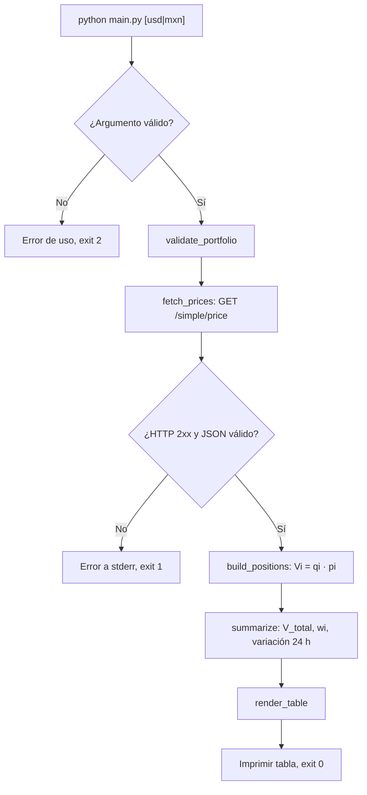

# Crypto Portfolio CLI


-green)

Rastreador de portafolio de criptomonedas para la terminal. Consulta precios en
tiempo casi real a la API pública de [CoinGecko](https://www.coingecko.com/en/api),
valora tus posiciones en **USD** o **MXN** y muestra una tabla alineada con el
valor de cada activo, su peso dentro del portafolio y su variación en 24 horas.

No requiere API key, base de datos ni configuración: una sola dependencia
(`requests`) y un único archivo ejecutable.

## Características

- Cotización en `usd` o `mxn` mediante un argumento de línea de comandos.
- Portafolio definido como colección de activos y balances (`PORTFOLIO` en `main.py`).
- Una sola petición HTTP para todos los activos (`/simple/price` acepta varios `ids`).
- Salida en tabla ASCII con anchos dinámicos, separadores de miles y porcentajes.
- Manejo explícito de errores (`requests.RequestException`, `KeyError`, `ValueError`)
  con mensajes claros en `stderr` y códigos de salida útiles para scripting.

## Modelo matemático

Para cada activo `i`, con cantidad `qᵢ` y precio unitario `pᵢ`:

```text
Valor individual      Vᵢ = qᵢ · pᵢ
Valor total           V_total = Σ Vᵢ
Ponderación           wᵢ = (Vᵢ / V_total) · 100          (Σ wᵢ = 100)
Variación 24 h total  Δ = (V_total − Σ V_prevᵢ) / Σ V_prevᵢ · 100
                      donde V_prevᵢ = Vᵢ / (1 + cambioᵢ/100)
```

La variación total se pondera por valor: no es el promedio simple de los
porcentajes individuales. Si la API no devuelve el cambio de un activo, se muestra
`N/D` y se asume 0 % para el cálculo del total.

## Arquitectura

El script está organizado en funciones de responsabilidad única:

| Función | Responsabilidad |
|---|---|
| `parse_currency` | Lee y valida `sys.argv` |
| `validate_portfolio` | Valida estructura y balances del portafolio |
| `fetch_prices` | Petición HTTP a CoinGecko (timeout, status, JSON) |
| `build_positions` | Cruza portafolio y precios; calcula `Vᵢ` |
| `summarize` | Calcula `V_total`, `wᵢ` y la variación 24 h total |
| `render_table` | Construye la tabla con alineación estricta |
| `main` | Orquesta el flujo y traduce excepciones a códigos de salida |



## Requisitos

- Python 3.8 o superior
- Conexión a internet

## Instalación

```bash
git clone https://github.com/<TU_USUARIO>/crypto-portfolio-cli.git
cd crypto-portfolio-cli

# Entorno virtual (recomendado)
python -m venv .venv

# Activar: Linux / macOS
source .venv/bin/activate
# Activar: Windows (PowerShell)
.venv\Scripts\Activate.ps1

pip install -r requirements.txt
```

## Uso

```bash
python main.py          # USD por defecto
python main.py usd      # dólares estadounidenses
python main.py mxn      # pesos mexicanos
python main.py --help   # ayuda
```

### Ejemplo: USD

> Los precios de estos ejemplos son ilustrativos.

```text
Portafolio cripto - USD - 2026-10-02 23:52:31

+--------+-----------+--------------+-------------+---------+--------+
| Activo |   Balance | Precio (USD) | Valor (USD) |    Peso |    24h |
+--------+-----------+--------------+-------------+---------+--------+
| BTC    |      0.50 |   $67,250.12 |  $33,625.06 |  45.98% | +1.83% |
| SOL    |    120.00 |      $148.30 |  $17,796.00 |  24.33% | +3.21% |
| ETH    |      4.25 |    $2,610.55 |  $11,094.84 |  15.17% | -0.41% |
| ADA    | 15,000.00 |    $0.452100 |   $6,781.50 |   9.27% | -1.05% |
| DOGE   | 25,000.00 |    $0.153400 |   $3,835.00 |   5.24% |    N/D |
+--------+-----------+--------------+-------------+---------+--------+
| TOTAL  |           |              |  $73,132.40 | 100.00% | +1.44% |
+--------+-----------+--------------+-------------+---------+--------+
```

### Ejemplo: MXN

```text
Portafolio cripto - MXN - 2026-10-02 23:52:31

+--------+-----------+---------------+---------------+---------+--------+
| Activo |   Balance |  Precio (MXN) |   Valor (MXN) |    Peso |    24h |
+--------+-----------+---------------+---------------+---------+--------+
| BTC    |      0.50 | $1,244,127.22 |   $622,063.61 |  45.98% | +1.83% |
| SOL    |    120.00 |     $2,743.55 |   $329,226.00 |  24.33% | +3.21% |
| ETH    |      4.25 |    $48,295.18 |   $205,254.49 |  15.17% | -0.41% |
| ADA    | 15,000.00 |         $8.36 |   $125,457.75 |   9.27% | -1.05% |
| DOGE   | 25,000.00 |         $2.84 |    $70,947.50 |   5.24% |    N/D |
+--------+-----------+---------------+---------------+---------+--------+
| TOTAL  |           |               | $1,352,949.35 | 100.00% | +1.44% |
+--------+-----------+---------------+---------------+---------+--------+
```

### Ejemplos de error

```text
$ python main.py eur
Error de uso: moneda no soportada 'eur'. Opciones: usd, mxn.

$ python main.py            # sin conexión
Error de red al consultar CoinGecko: Failed to resolve api.coingecko.com

$ python main.py            # id inexistente en PORTFOLIO
Error de datos: la API no devolvió precio para 'solana' en USD (¿el id es correcto?).
```

| Código de salida | Significado |
|---|---|
| `0` | Ejecución correcta |
| `1` | Error de red, HTTP (p. ej. 429) o de datos |
| `2` | Argumentos inválidos |

## Personalizar tu portafolio

Edita el diccionario `PORTFOLIO` en `main.py`. La llave es el **id** de CoinGecko
(por ejemplo `bitcoin`, no `BTC`); la lista completa está en
<https://api.coingecko.com/api/v3/coins/list>.

```python
PORTFOLIO = {
    "bitcoin": {"symbol": "BTC", "balance": 0.5},
    "ethereum": {"symbol": "ETH", "balance": 4.25},
}
```

## Limitaciones

- La API pública gratuita tiene límite de peticiones; ante un `429`, espera un minuto.
- Los precios son referenciales y pueden tener retraso respecto a un exchange.
- Este proyecto es educativo y no constituye asesoría financiera.

## Roadmap

- [ ] Cargar el portafolio desde un archivo `portfolio.json`.
- [ ] Pruebas unitarias con `pytest` y `unittest.mock`.
- [ ] Exportar la tabla a CSV.
- [ ] Soporte para más monedas de cotización.
